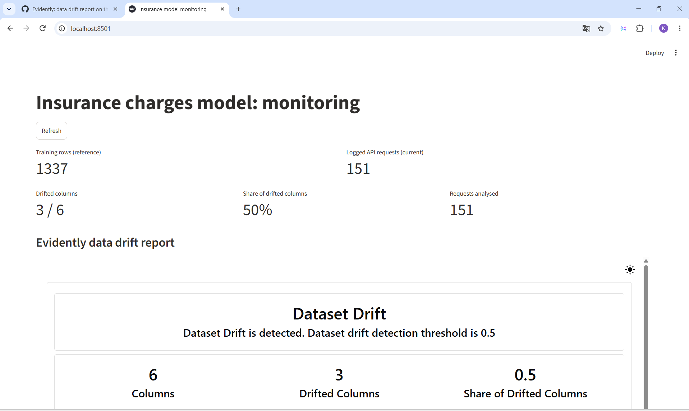

# Insurance charges – MLSecOps projekt

Féléves beadandó az **MLSecOps** tárgyhoz.
Egy egészségbiztosítási adathalmazon (életkor, nem, BMI, gyerekek száma, dohányzás, régió) gépi tanulási modell
jósolja meg az éves orvosi költséget (`charges`, **regresszió**), a modell köré pedig egy teljes MLOps folyamat épül:
verziókezelés, kísérletkövetés, model registry, REST API, konténerizálás, automatikus ellenőrzések és drift-monitorozás.

| | |
|---|---|
| **Szerző** | Takács Kitti (Neptun: XPLKVE) |
| **Dataset** | [Medical Cost Personal Dataset (Kaggle)](https://www.kaggle.com/datasets/mirichoi0218/insurance) – licenc: [ODbL DbCL 1.0](https://opendatacommons.org/licenses/dbcl/1-0/) |
| **Célváltozó / feladat** | `charges` / regresszió |
| **Indítás** | `docker compose up --build` |

## Architektúra

```
                 ┌──────────────┐   dvc repro    ┌────────────────────┐
  data/raw  ───► │  prepare.py  │ ─────────────► │ data/processed/... │
  (DVC)          └──────────────┘                └─────────┬──────────┘
                                                           │
                       ┌───────────────────────────────────┤
                       ▼                                   ▼
               ┌──────────────┐  logs runs,        ┌──────────────┐
               │   trainer    │  registers model   │     api      │  POST /train, POST /predict
               │  (train.py)  │ ─────────────────► │  (FastAPI)   │ ◄──── kliens / simulate.py
               └──────────────┘        │           └──────┬───────┘
                                       ▼                  │ minden kérés + jóslat
                               ┌──────────────┐           ▼
                               │ MLflow server│    logs/predictions.csv  ──►  ┌────────────────┐
                               │ + registry   │                                │   streamlit    │
                               │ (@champion)  │       data/processed  ──────►  │ + Evidently    │
                               └──────────────┘                                │  drift report  │
                                                                               └────────────────┘
```

A `docker compose up` négy szolgáltatást indít:

| Szolgáltatás | Feladat | Cím |
|---|---|---|
| `mlflow` | kísérletkövetés és model registry (adatai egy volume-ban) | http://localhost:5000 |
| `trainer` | induláskor egyszer lefuttat egy tanítást, utána leáll | – |
| `api` | FastAPI: `/train`, `/predict`, `/health` | http://localhost:8000/docs |
| `streamlit` | monitoring dashboard az Evidently drift riporttal | http://localhost:8501 |

## Mappaszerkezet

```
├── src/insurance/          # az üzleti logika (minden itt van, ezt méri a coverage)
│   ├── config.py           # útvonalak, oszlopnevek, MLflow beállítások
│   ├── prepare.py          # előfeldolgozás (DVC stage)
│   ├── train.py            # tanítás, MLflow tracking, champion logika (DVC stage)
│   ├── api.py              # REST API
│   ├── monitoring.py       # Evidently drift riport
│   └── simulate.py         # forgalom küldése az API-nak (normál vagy eltolt)
├── dashboard/app.py        # Streamlit – csak megjelenítés
├── tests/                  # pytest tesztek (100% coverage)
├── data/                   # csak a DVC mutatófájlok vannak a Gitben
├── docs/screenshots/       # a futtatásról készült képek
├── dvc.yaml, dvc.lock      # a pipeline: prepare -> train
├── Dockerfile, compose.yaml
├── .github/workflows/ci.yml
├── .pre-commit-config.yaml
├── pyproject.toml          # pytest, coverage, pyright beállítások
└── requirements*.txt       # minden csomag pontos verzióval
```
## Indítás

### Gyors indítás (Docker)

Előfeltétel: Docker Desktop (vagy Docker Engine + Compose).

1. **Adat.** A tisztított adatfájlnak itt kell lennie: `data/processed/insurance_clean.csv`.
   - Ha a projekt a saját gépemen fut: `dvc pull` vagy `dvc repro` elkészíti.
   - Más gépen: a DVC tárhely helyi mappa (lásd [Döntések](#döntések-és-indoklások)), ezért a beadott ZIP-ben
     található `insurance_clean.csv` fájlt kell a `data/processed/` mappába másolni.
2. **Indítás:**
   ```bash
   docker compose up --build
   ```
   Az első build néhány percig tart. Kész, ha a logban megjelenik: `trainer-1 exited with code 0`.
3. **Kipróbálás:**
   - Swagger: http://localhost:8000/docs → `POST /predict` → *Try it out*
   - MLflow: http://localhost:5000
   - Dashboard: http://localhost:8501
4. **Forgalom a drift riporthoz** (másik terminálban, a helyi Python környezetből):
   ```bash
   python -m insurance.simulate --n 50            # normál forgalom
   python -m insurance.simulate --n 100 --shift   # idősebb, magasabb BMI-jű emberek → drift
   ```
   Utána a dashboardon *Refresh*.
5. **Leállítás:** `Ctrl+C`, majd `docker compose down` (a volume-ok, vagyis az MLflow adatai megmaradnak).

### Helyi fejlesztői környezet

```bash
python -m venv .venv
.venv\Scripts\Activate.ps1          # Windows PowerShell  (Linux/macOS: source .venv/bin/activate)
pip install -r requirements-dev.txt
pip install -e .
pre-commit install
```

| Parancs | Mit csinál |
|---|---|
| `dvc repro` | lefuttatja a pipeline-t (prepare → train), csak a megváltozott lépéseket |
| `dvc metrics show` | az utolsó tanítás eredménye |
| `pytest` | tesztek + coverage (95% alatt elbukik) |
| `pre-commit run --all-files` | flake8, pyright és fájlellenőrzések |
| `uvicorn insurance.api:app` | az API helyben (http://localhost:8000/docs) |
| `mlflow ui --backend-store-uri sqlite:///mlflow.db` | a helyi MLflow felület |
| `python -m insurance.monitoring` | drift riport a `reports/drift_report.html` fájlba |
| `streamlit run dashboard/app.py` | a dashboard helyben |

## A gépi tanulási folyamat

### Adat és előfeldolgozás (DVC)
- A nyers CSV (1338 sor, 7 oszlop) **DVC**-vel van verziózva; a Gitben csak a `data/raw/insurance.csv.dvc` mutatófájl van.
- `prepare.py`: ellenőrzi, hogy minden várt oszlop megvan, kiszűri a duplikált és hiányos sorokat
  (1 duplikátum volt → **1337 sor**), és elmenti a `data/processed/insurance_clean.csv` fájlt.
- A `dvc.yaml` két lépést ír le (`prepare` → `train`); a `dvc repro` csak azt futtatja újra, aminek a bemenete változott.

### Tanítás és MLflow
- Minden tanításkor **három modell** versenyez: lineáris regresszió, random forest, gradient boosting.
  A kategóriás oszlopok one-hot kódolása a scikit-learn `Pipeline` része, így az API nyers adatot fogad.
- Minden modell egy **MLflow run**: paraméterek, metrikák (RMSE, MAE, R²) és a modell maga (artifact).
- **A modell jóságának automatikus védelme (champion logika):**
  1. a legjobb új modellt (legkisebb RMSE) összevetjük a registryben lévő `@champion` modellel **ugyanazon** a tesztadaton;
  2. csak akkor kerül be új verzióként a registrybe és kapja meg a `@champion` címkét, ha **szigorúan jobb**;
  3. ha nem jobb, a régi champion marad – romlás nem kerülhet élesbe.
- A modelleket az MLflow **skops** formátumban menti pickle helyett, így betöltéskor nem futhat tetszőleges kód
  (csak a kifejezetten megbízhatónak jelölt típusok töltődnek be).

### REST API
| Végpont | Leírás |
|---|---|
| `POST /train` | lefuttat egy tanítást (a champion logikával), és visszaadja az eredményt |
| `POST /predict` | egy személy adataiból jósol, a mindenkori `@champion` modellel |
| `GET /health` | állapotellenőrzés (a Docker healthcheck használja) |

- **Bemenet-ellenőrzés (Pydantic):** életkor 18–100, BMI 10–80, `smoker` csak `yes`/`no` stb.;
  minden más kérés **422** hibát kap, még mielőtt a modellhez érne.
- Minden jóslás **naplózva** van: a `logs/predictions.csv` fájlba (az Evidently bemenete) és
  MLflow runként az `insurance-predictions` kísérletbe (a kérés és a válasz JSON artifactként).

### Drift monitorozás (Evidently + Streamlit)
- Az Evidently a naplózott kéréseket veti össze a tanítóadattal: számoknál Kolmogorov–Szmirnov,
  kategóriáknál khi-négyzet próbával (legalább 20 kérés kell).
- A Streamlit dashboard csak megjelenít: a számokat, a teljes Evidently riportot és az utolsó jóslatokat.
- Kipróbálva: normál forgalomnál 0–1 oszlop jelez driftet, `--shift`-tel az `age` és a `bmi` egyértelműen.

## Minőség, automatizálás és Git

| Szabály (kiírás) | Megoldás | Eredmény |
|---|---|---|
| Tesztek, coverage min. 95% (`src` + `tests`) | pytest + pytest-cov, a `pyproject.toml`-ban `--cov-fail-under=95` | **100%** |
| PEP8, max. 1% hiba, line-length 120 | flake8 (`.flake8`) | **0 hiba**, `noqa` nincs |
| Pyright standard, `src/` | pyright | **0 hiba** |
| Extra: Pyright „szelíd strict” | a kiírás konfigurációja a `pyproject.toml`-ban | **0 hiba** |
| Pontos verziók | a `requirements*.txt`-ben minden csomag (a közvetettek is) `==`-vel | |
| `# pragma: no cover`, `omit` | nincs használva | |

**pre-commit** (`.pre-commit-config.yaml`): minden `git commit` előtt lefut a flake8, a pyright és néhány
fájlellenőrzés; hibánál a commit nem jön létre.

**GitHub Actions** (`.github/workflows/ci.yml`), minden pushra és pull requestre:
1. *Lint, type check, tests and coverage* – a pre-commit hookok és a tesztek a 95%-os küszöbbel (a coverage riport letölthető artifact);
2. *Build the Docker image* – felépíti az image-et és kipróbálja (csak sikeres tesztek után fut).

**Git munkafolyamat:**
- minden funkció külön **feature branchen** készült, **pull requesttel** és **merge committal** került a `main`-re
  (a branchek megmaradtak);
- a `main`-t egy GitHub ruleset védi: csak PR-rel módosítható, és csak zöld CI mellett mergelhető;
- a commitok formátuma: `feat:`, `fix:`, `test:`, `docs:`, `build:`, `ci:`, `chore:`, `style:`, `refactor:`.

## Screenshotok

Minden kép a [`docs/screenshots`](docs/screenshots) mappában van.

| Téma | Kép |
|---|---|
| REST API – sikeres jóslás (Swagger) | [swagger_test.png](docs/screenshots/swagger_test.png) |
| REST API – hibás bemenet, 422 | [swagger_test_error.png](docs/screenshots/swagger_test_error.png) |
| REST API – tanítás | [swagger_train.png](docs/screenshots/swagger_train.png) |
| MLflow – kísérletek | [mlflow_experiments.png](docs/screenshots/mlflow_experiments.png) |
| MLflow – model registry (`@champion`) | [mlflow_model_registry.png](docs/screenshots/mlflow_model_registry.png) |
| MLflow – jóslás artifactja | [mlflow_prediction_artifact.png](docs/screenshots/mlflow_prediction_artifact.png) |
| Docker – futó szolgáltatások | [docker_compose_ps.png](docs/screenshots/docker_compose_ps.png), [docker_desktop.png](docs/screenshots/docker_desktop.png) |
| Streamlit dashboard + Evidently | [streamlit_dashboard.png](docs/screenshots/streamlit_dashboard.png), [streamlit_evidently_report.png](docs/screenshots/streamlit_evidently_report.png) |
| GitHub Actions – zöld futás | [github_actions.png](docs/screenshots/github_actions.png) |


